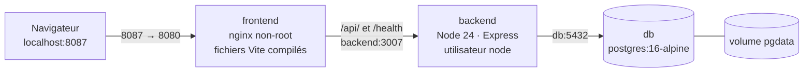
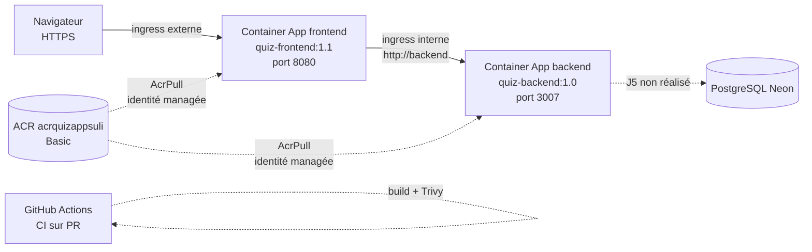

# Quiz App – Projet d'évaluation Conteneurisation

**Binôme :** Suliman Mouffok (`sulispurz`) · Tarmeekan Thurairajasingam (`Tarmi95`)
**Mastère DevOps & Cloud – 26/11/2026**

> Les consignes du formateur sont conservées dans [`docs/`](docs/) (sujet initial : [`docs/00-sujet.md`](docs/00-sujet.md)).
> Ce README documente **notre** travail : choix techniques, lancement, déploiement, preuves.
> Le code applicatif fourni n'a pas été modifié (aucune modification de la logique métier).

## Liens utiles

| Élément | Lien |
|---|---|
| Dépôt du groupe (fork) | https://github.com/Tarmi95/eval-quiz-app |
| Pull Requests | https://github.com/Tarmi95/eval-quiz-app/pulls?q=is%3Apr |
| CI verte (PR de déploiement Azure) | https://github.com/Tarmi95/eval-quiz-app/pull/10/checks |
| CI rouge, fusion bloquée (démonstration) | https://github.com/Tarmi95/eval-quiz-app/pull/9 |
| Application déployée sur Azure (frontend) | https://frontend.victoriouscliff-0d822295.belgiumcentral.azurecontainerapps.io |
| Healthcheck via le frontend Azure | https://frontend.victoriouscliff-0d822295.belgiumcentral.azurecontainerapps.io/health |
| Preuves par jalon | [`preuves/`](preuves/) |

## État des jalons

| Jalon | Contenu | État | Preuves |
|---|---|---|---|
| **J0** | Vérification de l'abonnement Azure | ✅ Restrictions identifiées et levées (fournisseurs, région) | §5 |
| **J1** | Conteneurisation locale (Dockerfiles, Compose, PostgreSQL persistant) | ✅ Validé par le formateur | [`preuves/J1/`](preuves/J1/) |
| **J2** | Sécurité des images (Trivy avant/après) | ✅ 30 failles HIGH/CRITICAL → 0, conteneurs non-root | [`preuves/J2/`](preuves/J2/) |
| **J3** | Azure CLI + ACR | ✅ Registre `acrquizappsuli`, images taguées `1.0` / `1.1` | [`preuves/J3/`](preuves/J3/) |
| **J4** | Frontend et backend sur Azure Container Apps | ✅ `/health` → HTTP 200 `{"status":"ok"}` | [`preuves/J4/`](preuves/J4/) |
| **J5** | PostgreSQL cloud (Neon) | ❌ Non réalisé (temps) – démarche en §7 | — |
| **J6-A** | CI sur Pull Request (build + Trivy bloquant) | ✅ Contrôles obligatoires, vert et rouge démontrés | [`preuves/J6/`](preuves/J6/) |
| **J6-B** | CD après fusion (ACR + mise à jour Container Apps) | ❌ Non réalisé (temps) – démarche en §6 | — |

---

## 1. Architecture

### Locale (Docker Compose)



- Le navigateur ne parle jamais directement au backend : `main.js` appelle `/api/...` (URL relative) et **nginx** relaie `/api/` et `/health` (reverse proxy).
- Les services se joignent **par leur nom** (`db`, `backend`) sur le réseau créé par Compose. La base n'est **pas** exposée sur l'hôte.
- Les données PostgreSQL vivent dans le volume nommé **`pgdata`**.

### Cloud (Azure – région Belgium Central)



---

## 2. Lancer le projet en local

**Prérequis :** Docker + Docker Compose v2 (testé sous WSL 2 : Ubuntu 24.04 et Debian 13).

```bash
git clone https://github.com/Tarmi95/eval-quiz-app.git
cd eval-quiz-app
cp .env.example .env          # puis remplacer les mots de passe dans .env
docker compose up -d --build
docker compose ps             # les 3 services doivent être "healthy"
```

- Quiz : http://localhost:8087 (sujets en minuscules : `docker`, `ansible`, `devops`, `cicd`, `scm`, `usine-logicielle`)
- Administration : http://localhost:8087/gestion-quiz (identifiants `ADMIN_USERNAME` / `ADMIN_PASSWORD` du `.env`)
- Santé : `curl http://localhost:8087/health` → `{"status":"ok"}`

**Arrêter :** `docker compose down` (garde les données) · **Tout effacer :** `docker compose down -v` (supprime le volume, rejoue `init.sql` au prochain démarrage).

> ⚠️ Après un `git pull` qui modifie un Dockerfile ou un fichier copié dans une image, toujours relancer avec `--build`, sinon l'ancienne image est réutilisée.

### Variables d'environnement

`.env` n'est **jamais versionné** (`.gitignore`, vérifié avec `git check-ignore -v .env`) ; seul `.env.example` (valeurs fictives) l'est.

| Variable | Rôle | Sensible |
|---|---|---|
| `POSTGRES_USER`, `POSTGRES_DB` | Utilisateur et base PostgreSQL locaux | Non |
| `POSTGRES_PASSWORD` | Mot de passe PostgreSQL local | **Oui** |
| `DATABASE_URL` | Construite par Compose : `postgres://user:mdp@db:5432/base` | **Oui** |
| `ADMIN_USERNAME` | Identifiant administrateur | Non |
| `ADMIN_PASSWORD`, `JWT_SECRET` | Mot de passe admin, signature des jetons JWT | **Oui** |
| `RESEND_API_KEY` | Clé du service d'emails | **Oui** |
| `FROM_EMAIL` | Expéditeur des emails | Non |

> `RESEND_API_KEY` doit avoir une valeur (même fictive) : `server.js` crée le client Resend au démarrage et plante sans clé. L'envoi d'email échoue alors proprement (erreur interceptée) et le résultat est quand même enregistré.

### Tests réalisés (voir `preuves/J1/`)

| Test | Commande | Résultat |
|---|---|---|
| Pages du frontend | `curl -o /dev/null -w "%{http_code}" localhost:8087/` et `/gestion-quiz` | 200 / 200 |
| Proxy nginx → backend | `curl localhost:8087/health` | `{"status":"ok"}` |
| Backend → base | `POST /api/users` | `{"id":1,...}` |
| Tables créées par `init.sql` | `docker compose exec db psql -U quiz_user -d quiz_db -c '\dt'` | `users`, `quiz_results`, `answers` |
| Quiz complet | Quiz `docker` jusqu'au score, puis `SELECT ... FROM quiz_results` | 1 ligne enregistrée |
| Persistance | `docker compose down` puis `up -d` (sans `-v`) puis même `SELECT` | données conservées |
| Non-root | `docker compose exec backend whoami` / `frontend ps -o user,comm` | `node` / `nginx` uniquement |

---

## 3. Choix techniques

### Backend – `backend/Dockerfile`
- **`node:24-alpine`** : image légère (moins de paquets = moins de failles). Node 20 est en fin de vie depuis avril 2026 ; le sujet demande Node 20 ou supérieur.
- **`apk upgrade --no-cache`** : paquets système Alpine à jour.
- **`npm install --omit=dev`** (pas `npm ci`) : `backend/` n'a pas de `package-lock.json`.
- **Suppression de npm / npx / yarn** après installation : inutiles à l'exécution (`node server.js`), ils embarquaient la majorité des failles détectées.
- `COPY package.json` **avant** `COPY server.js` : réutilisation du **cache des couches**.
- **`USER node`** : pas de root. **`HEALTHCHECK`** sur `/health` (route qui ne dépend pas de la base).
- `CMD ["node", "server.js"]` en forme JSON : arrêt propre (`docker stop`).

### Frontend – `Dockerfile` (multi-stage)
- **Étape `build`** (`node:24-alpine AS build`) : `npm ci` puis `vite build` → `dist/` (les pages `index.html` et `gestion-quiz.html` sont déclarées dans `vite.config.js`).
- **Image finale `nginxinc/nginx-unprivileged:alpine`** : ne contient que `dist/` et la config nginx. Root uniquement le temps de `apk upgrade`, puis `USER nginx`.
- **Port 8080** au lieu de 80 : un processus non-root n'écoute normalement pas sous le port 1024. Le port hôte reste **8087** (`8087:8080`). EXPOSE, `listen` de nginx et `ports` du compose doivent rester cohérents.
- **Adresse du backend configurable** : `nginx/default.conf.template` contient `${BACKEND_HOST}`, remplacé au démarrage par le mécanisme de templates de l'image nginx.
  - local : `BACKEND_HOST=backend:3007` (valeur par défaut dans le Dockerfile) ;
  - Azure : `BACKEND_HOST=backend` (ingress interne, port 80, routage par l'en-tête `Host`).
  → **Une seule image** pour le local et le cloud (séparation code / configuration, `docs/01`).
- Healthcheck sur **`127.0.0.1:8080`** et non `localhost`, qui se résolvait en IPv6 (`::1`) alors que nginx écoute en IPv4.

### Base de données – image officielle plutôt qu'un Dockerfile
- `postgres:16-alpine` + `database/init.sql` monté dans `/docker-entrypoint-initdb.d/` (exécuté **une seule fois**, à la création du volume).
- Consignes : `docs/02` (« Dockerfiles **nécessaires** ») et `docs/08` (« PostgreSQL orchestrée par Docker Compose, avec stockage persistant »).
- **Alternative écartée** : un `database/Dockerfile` (`FROM postgres:16-alpine` + `COPY init.sql`) ; une image de plus à construire, scanner et maintenir, pour un usage uniquement local.
- Version **16 fixée** : à partir de PostgreSQL 18, l'image change de dossier de données, ce qui casserait le volume.
- `healthcheck` `pg_isready` + `depends_on: condition: service_healthy` : le backend attend que la base soit prête.

### Secrets
- `.dockerignore` (racine et `backend/`) : ni `.env`, ni `node_modules`, ni `.git` dans les images. Trivy confirme : **aucun secret** dans les images.
- Azure : `ADMIN_PASSWORD` et `JWT_SECRET` stockés en **secrets Container Apps** (`secretref:`), générés aléatoirement (`openssl rand`), jamais écrits dans le dépôt ni dans les scripts.

---

## 4. Sécurité – Trivy (J2)

```bash
docker run --rm -v /var/run/docker.sock:/var/run/docker.sock -v trivy-cache:/root/.cache/ \
  aquasec/trivy:latest image --severity HIGH,CRITICAL quiz-backend:dev
```

| Image | Avant | Après |
|---|---|---|
| quiz-backend | alpine 3.23 : 7 HIGH · node-pkg : 22 (21 HIGH, **1 CRITICAL**) → **29** | **0** |
| quiz-frontend | alpine : 1 HIGH (libxml2) | **0** |
| Secrets | aucun | aucun |

| Correction | Effet |
|---|---|
| `node:20-alpine` → `node:24-alpine` | Version maintenue, base Alpine plus récente |
| `apk upgrade --no-cache` | Corrige les failles système (openssl, musl, zlib, libxml2) |
| Suppression de npm/yarn de l'image backend | Supprime les 22 failles node-pkg (dépendances **internes de npm** : `tar` CRITICAL, `minimatch`, `glob`…), aucune ne venait de notre code |
| Frontend `nginx-unprivileged` | Plus aucun processus root (backend déjà en `USER node`) |

- **Compromis** : tailles légèrement en hausse (backend 52 → 69 Mo, frontend 26 → 30 Mo) car `apk upgrade` ajoute une couche. On privilégie l'absence de faille connue.
- **Vulnérabilités résiduelles** : aucune HIGH/CRITICAL au 26/11/2026 ; MEDIUM/LOW hors périmètre. De nouvelles CVE sortent chaque jour, d'où le scan automatique en CI.
- **Limite constatée** : une image `node:14-alpine` passait aussi le scan. Trivy ne voit pas qu'un binaire Node est en fin de vie (ce n'est pas un paquet qu'il identifie) : un scan à 0 ne garantit pas tout.
- Rapports complets : `preuves/J2/trivy-*-avant.txt` et `trivy-*-apres.txt`.

---

## 5. Azure (J0 · J3 · J4)

### J0 – Vérifications et restrictions rencontrées
| Constat | Action |
|---|---|
| Abonnement **Azure for Students**, actif, rôle **Owner** | — |
| Fournisseurs `Microsoft.ContainerRegistry`, `Microsoft.App`, `Microsoft.OperationalInsights` en **NotRegistered** | `az provider register -n <fournisseur> --wait` → Registered |
| **France Central refusée** (`RequestDisallowedByAzure`, restriction Azure for Students) | Régions testées par validation sans déploiement ; **Belgium Central** retenue (la plus proche, UE) |
| Container Apps disponible en Belgium Central ? | Vérifié (`az provider show -n Microsoft.App ...`) ✅ |

### Ressources

| Ressource | Nom | Détail |
|---|---|---|
| Groupe de ressources | `rg-quiz-app` | Supprimer le groupe supprime tout |
| Registre | `acrquizappsuli` | SKU **Basic** (configuration minimale, `docs/02`) |
| Environnement Container Apps | `env-quiz-app` | Consommation, logs Log Analytics |
| Container App | `backend` | `quiz-backend:1.0`, ingress **interne** (pas d'URL publique), port 3007, 0,25 vCPU / 0,5 Gi |
| Container App | `frontend` | `quiz-frontend:1.1`, ingress **externe** HTTPS, port 8080, `BACKEND_HOST=backend` |

- **Accès au registre par identité managée** + rôle **AcrPull** limité au registre (moindre privilège) : aucun mot de passe d'ACR stocké.
- Le groupe de ressources et l'ACR ont été créés via le **portail Azure** (avec l'accord du formateur) ; les Container Apps et toute la suite en **Azure CLI**. L'ensemble est rejouable avec `scripts/deploy.sh`.

### Scripts
```bash
az login
export ADMIN_PASSWORD="$(openssl rand -base64 18)" JWT_SECRET="$(openssl rand -hex 32)"
./scripts/deploy.sh          # crée tout (groupe, ACR, images, environnement, 2 apps)
./scripts/destroy.sh         # supprime le groupe rg-quiz-app (demande confirmation)
```
Aucun secret dans les scripts : ils sont lus dans l'environnement, et le script s'arrête s'ils manquent.

### Vérifier le déploiement
```bash
curl https://frontend.victoriouscliff-0d822295.belgiumcentral.azurecontainerapps.io/health
# {"status":"ok"}  ← Internet → frontend (nginx) → backend privé
az containerapp revision list -n backend -g rg-quiz-app -o table
az containerapp logs show -n backend -g rg-quiz-app --tail 20
```

`/health` ne prouve pas la disponibilité de la base (la route ne l'interroge pas) : le backend démarre sans PostgreSQL, car il ne s'y connecte qu'à la première requête.

---

## 6. CI/CD (J6)

### Organisation Git et protection de `main`
- Une tâche = une branche `feature/*` = une PR vers `main` **du fork** (jamais vers le dépôt du formateur).
- `main` protégée par un **ruleset actif** : pas de push direct (refus `GH013` testé), pas de force-push ni de suppression, PR obligatoire avec **1 approbation**, et les **2 contrôles CI obligatoires**.

### J6-A – CI sur Pull Request ✅
Fichier : [`.github/workflows/ci.yml`](.github/workflows/ci.yml)
- Déclenchement : chaque **Pull Request vers `main`**, **sans aucun déploiement**. Permissions minimales (`contents: read`).
- Matrice **backend / frontend** en parallèle : `docker build` (image taguée avec le SHA du commit) puis **Trivy** `severity: CRITICAL`, `exit-code: 1`, **sans `continue-on-error`** → une faille CRITICAL fait échouer le contrôle et **bloque** la fusion.
- `aquasecurity/trivy-action` fixée en **v0.35.0** : les autres tags de cette action ont été compromis en mars 2026 (CVE-2026-33634).
- Rapports Trivy conservés en artefacts, même en cas d'échec (`if: always()`).
- **Démonstration contrôlée** : PR #9 avec une image Debian buster obsolète → contrôle backend rouge, « Merging is blocked » ; PR fermée sans fusion, image jamais publiée.

### J6-B – CD après fusion ❌ (non réalisé, démarche prévue)
Un second workflow `on: push: branches: [main]` qui :
1. se connecte à Azure par **OIDC** (`azure/login`, identité fédérée, aucun secret long terme dans GitHub) ;
2. construit et pousse les images dans l'ACR avec un tag = SHA du commit ;
3. met à jour les Container Apps : `az containerapp update -n backend --image acrquizappsuli.azurecr.io/quiz-backend:<sha>` (idem frontend) → nouvelle **révision**.

---

## 7. Incidents, anomalies et ce qui n'a pas été fait

### Incidents diagnostiqués

| Symptôme | Diagnostic | Cause | Solution |
|---|---|---|---|
| Base en `Restarting`, site inaccessible | Lignes `WARN ... variable is not set` au lancement | Pas de `.env` : Postgres démarre sans mot de passe | `cp .env.example .env`, base réinitialisée |
| Frontend `unhealthy` alors que le site répond | `docker inspect ... .State.Health.Log` → `Connection refused` | `localhost` résolu en IPv6 (`::1`), nginx en IPv4 | Healthcheck sur `127.0.0.1` |
| Backend Azure « Running » mais sur l'image de démo | `InternalServerError` à la création, logs de l'app | Attribution du rôle AcrPull échouée → image `k8se/quickstart` | `identity assign` → `role assignment create AcrPull` → `registry set --identity system` → `update --image` ; `deploy.sh` reprend ces étapes séparées |
| Aucune CI déclenchée | Onglet Actions : « No workflows found » | Fichier dans `.github/` au lieu de `.github/workflows/` | `git mv` |

### Anomalie de l'application (documentée, non corrigée : logique métier)
Si une question reste sans réponse, le frontend envoie `userAnswer: null`. La colonne `answers.user_answer` étant `NOT NULL`, l'insertion échoue et la transaction est annulée (`ROLLBACK`) : rien n'est enregistré. La page affiche pourtant « Résultats envoyés », car le frontend ne vérifie pas le code HTTP. Diagnostic : `docker compose logs backend | grep -i not-null`.

### Non réalisé

| Jalon | Raison | Démarche prévue |
|---|---|---|
| **J5 – PostgreSQL Neon** | Temps : priorité donnée à J4 et J6-A | Base Neon (PostgreSQL 16, même version qu'en local) → exécution de `init.sql` → `DATABASE_URL` avec `?sslmode=require` en **secret** Container Apps → test d'inscription et de persistance |
| **J6-B – CD** | Temps | Voir §6 |

---

## 8. Organisation du binôme

- Relecture croisée : chaque PR approuvée par l'autre membre avant fusion.
- Leçons apprises : une PR fusionnée ne reçoit plus les pushs suivants → attendre le feu vert de l'auteur ; ne jamais fusionner une PR qui n'affiche aucun contrôle CI.

| Suliman | Tarmeekan |
|---|---|
| Dockerfiles backend et frontend (multi-stage), `.dockerignore` | `docker-compose.yml`, PostgreSQL, volume, healthchecks |
| Scan Trivy et corrections, passage en non-root | CI GitHub Actions (J6-A), protection de `main`, démonstration CI rouge |
| Azure : J0, ACR, Container Apps, nginx configurable, scripts | Preuves J1 et J6, README, présentation |

---

## 9. Usage de l'IA

- **Outil utilisé :** Claude (Anthropic).
- **Tâches assistées :** explication de notions (couches Docker, multi-stage, non-root, volumes, transactions SQL, ingress Container Apps, identité managée), proposition de configurations (Dockerfiles, compose, template nginx, workflow CI, commandes Azure CLI, scripts), aide au diagnostic d'erreurs (`.env` absent, healthcheck IPv6, image non reconstruite, région refusée, `InternalServerError`, workflow mal placé), organisation du travail en binôme et rédaction de la documentation.
- **Vérification :** chaque proposition a été **testée** avant d'être gardée : builds Docker, scans Trivy avant/après, tests `curl` (pages, proxy, API, base), test de persistance, vérification non-root, `docker compose ps`, état des révisions et logs Azure, CI GitHub verte et rouge. Les résultats sont dans `preuves/`.
- **Secrets :** aucun secret réel n'est versionné. Un mot de passe administrateur saisi à la main a été visible pendant une session d'assistance : il a été **abandonné** au profit de secrets générés aléatoirement (`openssl rand`) et stockés en secrets Container Apps.
- Chaque membre est capable d'expliquer et de reproduire sans IA les éléments qu'il a réalisés.

## 10. Nettoyage
Après sauvegarde des preuves et accord du formateur :
```bash
./scripts/destroy.sh     # supprime rg-quiz-app : ACR, environnement, Container Apps, logs
```
